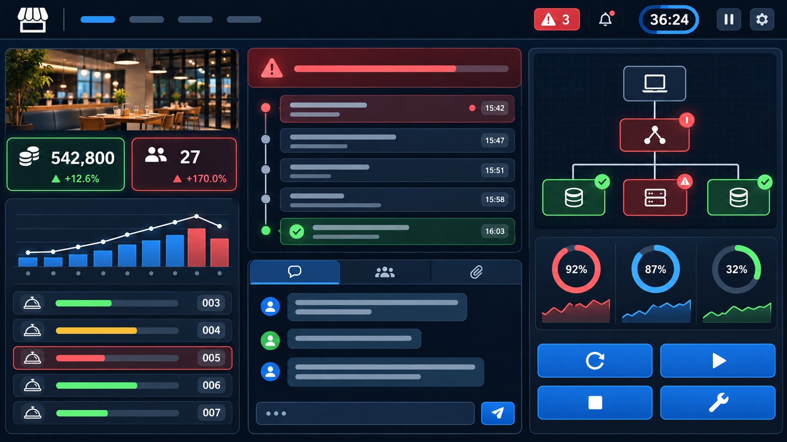

# おおたに食堂 Incident Room

インシデントコマンダーの判断を短時間で体験するブラウザゲームです。Redisのメモリ逼迫による障害に対応し、サービスの復旧とチームへの連絡・記録を体験できます。

**[デモを試す →](https://ham665.github.io/ootani-incident-response/)**

- **所要時間:** Easy 3分 / Normal 5分。一時停止・再開できます。
- **利用条件:** ブラウザで利用できます。アカウント登録・ログイン・APIキーの入力は不要です。
- **現在の内容:** Redisメモリ逼迫の1シナリオを収録。LLMを使わないシミュレーションです。



## デモの遊び方

1. デモページを開き、**Easy（3分）** または **Normal（5分）** を選びます。
2. アラートが発生したら **Acknowledge** し、レスポンダーに調査を依頼します。
3. システム図で **赤＝障害箇所／黄＝影響あり／緑＝正常** を確認します。Redis障害ではbackendとfrontendへの波及を表示します。
4. 調査完了後、レスポンダーの説明と所要時間を比較して **Redisコンテナ再起動（8秒）** または **Redisのメモリ設定修正（18秒）** を選びます。
5. **CTO・CSへ連絡** を開き、宛先（CTO／CS／両方）と **技術的／ビジネス的** な内容を選択します。プレビューで確認して送信すると履歴に残り、復旧後は復旧報告も送れます。
6. スクライブへ記録を依頼し、復旧後にアラートを **resolve** して、最終スコアを確認します。

プレイ画面はGitHub Pages、ゲーム状態を管理するAPIはCloudflare Workersで公開する構成です。

## 開発

```bash
npm install
npm run dev
```

`http://localhost:8787/health` でWorkerを確認し、`web/index.html` は任意の静的サーバーで開きます。ローカルAPIの既定値は `http://localhost:8787` です。

```bash
npm test
```

## デプロイ前の確認

`wrangler.jsonc` のWorker名は `ootani-incident-api` です。これは初回デプロイで作成される新規Workerです。既存Workerを更新しないこと、`npx wrangler whoami` で配置先アカウントを確認することを確認してから、所有者の明示的な了承を得て `npm run deploy` を実行します。

LLMは `LLM_ENABLED=false` が既定です。OpenRouterキーは実装・デプロイ後に `wrangler secret put OPENROUTER_API_KEY` で登録します。キー値をファイルやチャットに書き込まないでください。

## GitHub Pages

`.github/workflows/deploy-pages.yml` は `main` へのpush時、`web/` をGitHub Pagesへデプロイします。GitHubでリポジトリを作成・pushしたら、**Settings → Pages → Build and deployment → Source** を **GitHub Actions** に設定してください。

Pagesでは `web/config.js` が公開Worker URLを使います。公開前に `wrangler.jsonc` の `ALLOWED_ORIGINS` へPagesのOrigin（例: `https://<github-user>.github.io`。パスは含めない）を追加してWorkerを再デプロイしてください。APIキーなどの秘密情報をPagesのファイル・Actions変数へ置かないでください。
