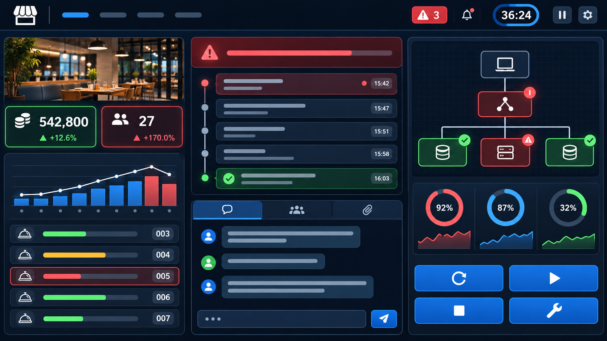

# おおたに食堂 Incident Room

インシデントコマンダーの判断を短時間で体験するブラウザゲームです。Redisのメモリ逼迫による障害に対応し、サービスの復旧とチームへの連絡・記録を体験できます。

**[制作記録・画面・操作動画 →](https://ham665.github.io/ootani-incident-response/)**

審査終了に伴い、2026-11-16に審査用デモの公開を終了しました。上記URLは紹介ページとして残しています。公開APIは停止し、紹介ページからAPIへの通信は行いません。

最終プレイ版は [demo-final-2026-11-16](https://github.com/ham665/ootani-incident-response/tree/demo-final-2026-11-16) に保存しています。[構成・停止時の確認事項・再公開手順](docs/retirement.md)も参照してください。

- **所要時間:** Easy 3分 / Normal 5分。一時停止・再開できます。
- **公開状況:** 現在は画面と操作動画のみ閲覧できます。ゲームは最終プレイ版タグから復元可能です。
- **現在の内容:** Redisメモリ逼迫の1シナリオを収録。LLMを使わないシミュレーションです。



## 最終プレイ版の遊び方（現在は公開停止）

1. デモページを開き、**Easy（3分）** または **Normal（5分）** を選びます。
2. アラートが発生したら **Acknowledge** し、レスポンダーに調査を依頼します。
3. システム図で **赤＝障害箇所／黄＝影響あり／緑＝正常** を確認します。Redis障害ではbackendとfrontendへの波及を表示します。
4. 調査完了後、レスポンダーの説明と所要時間を比較して **Redisコンテナ再起動（8秒）** または **Redisのメモリ設定修正（18秒）** を選びます。
5. **CTO・CSへ連絡** を開き、宛先（CTO／CS／両方）と **技術的／ビジネス的** な内容を選択します。プレビューで確認して送信すると履歴に残り、復旧後は復旧報告も送れます。
6. スクライブへ記録を依頼し、復旧後にアラートを **resolve** して、最終スコアを確認します。

プレイ画面はGitHub Pages、ゲーム状態を管理するAPIはCloudflare Workersで公開する構成です。

## 開発

```bash
npm install
npm run dev
```

現在の設定は公開終了ガードが有効なため、APIは410を返します。プレイ版を開発する場合は、最終プレイ版タグを別作業ツリーへ取得してください。ローカルAPIの既定値は `http://localhost:8787` です。

```bash
npm test
```

## デプロイ前の確認

`wrangler.jsonc` のWorker名は `ootani-incident-api` です。既存Workerと保存データを保持しており、公開経路だけを無効化しています。再公開は [再公開手順](docs/retirement.md) に従い、配置先と再公開の意図を確認してから実行します。

LLMは `LLM_ENABLED=false` が既定です。OpenRouterキーは実装・デプロイ後に `wrangler secret put OPENROUTER_API_KEY` で登録します。キー値をファイルやチャットに書き込まないでください。

## GitHub Pages

`.github/workflows/deploy-pages.yml` は `main` へのpush時、紹介ページのHTML・CSS・画像・動画だけをGitHub Pagesへデプロイします。ゲーム用JavaScriptとAPI接続設定は配布しません。

Pagesでは `web/config.js` が公開Worker URLを使います。公開前に `wrangler.jsonc` の `ALLOWED_ORIGINS` へPagesのOrigin（例: `https://<github-user>.github.io`。パスは含めない）を追加してWorkerを再デプロイしてください。APIキーなどの秘密情報をPagesのファイル・Actions変数へ置かないでください。
