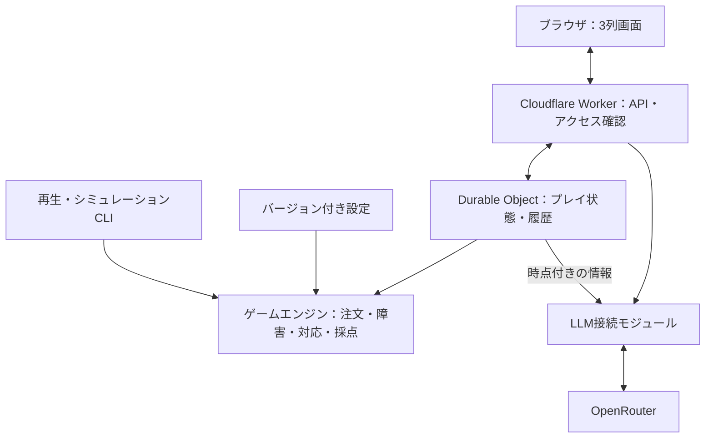

# おおたに食堂 インシデントコマンダー体験 — 基本設計・アーキテクチャ

更新日：2026-11-06 / 版：0.1 / 用途：実装開始に向けた合意事項と設計案の引き継ぎ

## 0. この文書の読み方

- **確定**：ユーザーが指定または同意した方針。
- **設計案**：会話で提示した実装案。細部まで承認済みという意味ではない。
- **未決・仮設定**：実装時に暫定値を明記し、プレイ検証で変更する。
- 本書は会話の決定事項を整理したもの。新たな実装・デプロイは行っていない。
- 作成済みモックの仮値を本仕様の確定値として扱わない。

## 1. 目的・範囲【確定】

短時間でインシデントコマンダーの役割を体験する、ブラウザ上のゲームを作る。架空の「おおたに食堂」の注文処理を維持し、障害対応をチームに指示し、関係者に報告する。文章を読むだけでなく、注文滞留、通信、停止、復旧、売上の変化を目で見て理解できることを重視する。

初期の用途は ai& Build Day への応募用プロジェクト・動くデモ。応募用作品とイベント当日の成果物は区別する。イベントの規則・締切等は実際の応募時に再確認する。

- プレイヤーはインシデントコマンダーのみ。
- easy 約3分、normal 約5分。具体的な難易度差はプレイしながら調整。
- 一時停止可能。ログイン不要。
- 同時に進行するインシデントは最大1件。
- システム、障害、注文、チャット、アラート管理サービスは模擬。実際のKubernetesやSlack、PagerDutyを操作しない。
- 言語・クラウド製品の知識を問うことを主目的としない。
- 脅威モデリング体験は別案として保留し、インシデントレスポンス体験を先に作る。

## 2. ゲーム内のサービス構成【確定】

クラウド事業者（AWSなど）上に、ALB＋WAF、Kubernetes基盤、frontend、backend、Redis、MySQLを想定する。frontend・backendの実装言語は固定しない。必要なシナリオで一般的なものを採用する。

| 要素 | 模擬上の役割 |
|---|---|
| ALB＋WAF | 外部アクセスの入口、振り分け、アクセス制御。図ではWAFをALBに関連付く制御として表現可能 |
| frontend | 顧客向け画面 |
| backend | 注文処理・業務処理 |
| Redis | キャッシュ。注文の正本ではない |
| MySQL | サービスが受け付けた注文の正本を保存 |
| Kubernetes | frontend・backend・Redisの実行基盤。MySQLを含めてもよい |

MySQLのクラスタ内外の配置は未固定。ゲームの実装基盤（Cloudflare）と、ゲーム内に描くクラウド／Kubernetes構成を混同しない。

### 注文要求と注文データの区別

障害でfrontendやMySQLが停止していても、ゲーム側は顧客からの未処理の注文要求を保持する。これはMySQLに保存済みの注文と同一ではない。画面上の待ち注文はこの未処理要求を含む。サービス復旧後、処理能力の上限内で順次処理する。

## 3. 注文・売上・障害【確定】

- 注文要求は一定間隔で到着する。
- 単位時間あたりの処理件数に上限がある。
- 状態は正常、性能低下、完全停止を表現する。
- 停止中も要求が蓄積し、復旧後に処理できる。
- 売上は処理完了件数×食事価格。
- 不審アクセスは正常注文とは別の負荷であり、売上に含めない。
- 障害候補を5〜10種類程度準備し、回数・間隔を制約して抽選する方針。
- 復旧後には一定の障害発生禁止期間を置く。
- 次の障害は「前件resolve済み」かつ「復旧後の待機時間経過」で発生可能。
- 暫定対応による再発も、同時1件と待機時間のルールに従う。

**設計案**：時間終了時の未処理注文は売上に含めず、残件数として表示する。新規障害が終了直前に発生することを防ぐため、発生可能な最終時刻を設定する。

## 4. ロールと操作【確定】

| ロール | 役割 |
|---|---|
| インシデントコマンダー（プレイヤー） | ack、調査指示、対応案選択、記録指示、resolve指示、CTO・CSへの初報・進捗・復旧報告 |
| レスポンダー | 指示後に調査し、対応案と所要時間を報告。選択された対応を実施 |
| スクライブ | 指示を受けて経過を記録。復旧後、指示を受けてアラートをresolve |
| CTO | サービスオーナー。売上・損失・影響・復旧見込みを知る |
| CS | 顧客案内のため、症状・影響・復旧見込みを知る |

操作は選択式を中心にする。全ロールを独立したLLMエージェントにする必要はない。

### 対応案選択の意味

対応案の選択そのものが実施指示となる。別の実行ボタンや追加承認は設けない。

1. 障害発生、アラーム表示。
2. コマンダーがacknowledge。
3. レスポンダーに調査を指示。スクライブへの記録指示、関係者報告は並行可能。
4. 調査時間後、対応案を提示。
5. コマンダーが選択した瞬間に対応開始。
6. 所要時間が経過すると復旧し、選択肢の効果を適用。
7. CTO・CSへ復旧報告。スクライブへresolve指示。
8. resolveと待機期間の条件を満たせば次の障害が発生可能。

| 種類 | 時間 | 復旧後の効果 |
|---|---|---|
| 応急処置・簡易対応 | 短い | 早く再開できるが原因が残り、再発し得る |
| 根本対応 | 長い | 該当原因の再発防止、処理能力向上など |

時間・効果は障害ごとに定義する。すべての根本対応に能力向上を与える必要はない。アクセス遮断が常に根本対応であるとも扱わず、「何を解消し、何が残るか」を表示する。

### 記録

記録開始の指示を行えばよい。指示漏れはコミュニケーション評価に反映する。開始後は自動記録する設計案。一方、内部のデバッグ履歴は指示の有無にかかわらず保存する。開始前の事実をスクライブが遡って記録するか、指示の有効範囲がインシデント単位かは未決。

## 5. トップ画面【確定した構成】

横並びの3列。

| 左：サービス | 中央：管理・報告 | 右：技術対応 |
|---|---|---|
| おおたに食堂の疑似画面 | 上部約1/3：アラート管理 | 上部：システム図 |
| 注文の到着・待機・処理完了 | アラート、ack、状態、経過時間 | 正常・性能低下・停止・調査・対処の表示 |
| 売上・待ち件数・処理能力 | 下部：Slack風のCTO・CS連絡 | 下部：レスポンダー・スクライブへの連絡 |

### UI設計案

- 共通バーに難易度、残り時間、一時停止。
- ackは中央、resolve指示は右のスクライブから行う。
- 復旧すると左と右が正常化し、中央にはクローズ待ちが残る。
- 対応案はチャット履歴に埋めず、選択カードとして保持する。
- 各発言者と報告先を明示。モックではCTO・CSにまとめて報告するが、最終仕様は未固定。
- 未調査の原因を最初から画面が教えるかは要調整。観測された異常と原因確定を区別する。

### 作成済みモック

https://ootani-incident-room.braceddeer2.chatgpt.site

3列、注文・売上、ack、調査、記録、暫定／根本対応選択、復旧報告、resolveの操作がある。LLM未接続、最終スコア未実装。単一のRedisシナリオによる画面確認用。モックの価格、調査時間、対応時間、注文間隔、処理能力等は仮値。今回、現行サイトの再検証やソース回収は行っていない。

## 6. 採点【方針確定／数値詳細は未決】

最終点は売上40点＋復旧30点＋コミュニケーション30点＝100点。

| 項目 | 満点の考え方 |
|---|---|
| 売上 | 理論上の最大売上より少し低い目標売上で満点。超えても40点 |
| 復旧 | 最短復旧時間に操作猶予を加えた時間まで満点 |
| コミュニケーション | 必要な記録・報告・resolve指示を猶予時間内に実施すると満点 |

売上点の案：`40 * min(actualRevenue / fullScoreRevenue, 1)`。

ゲーム内の復旧時間はアラート発生からサービス復旧までと定義する案。ackまでの時間は診断指標、復旧からresolveまでの遅れはコミュニケーション評価。実際のMTTRの用語解釈に依存せず、画面にも測定範囲を明示する。

### 必須要件

- 意図的なresolve遅延によって総合点が上がらないようにする。
- 未復旧・未resolveを評価から除外して有利にしない。
- 同じ報告の連打で加点しない。
- 各点数の根拠、適用した満点基準・ルールを保存する。
- LLMは点数を決定しない。

### 残る課題

40/30/30という配点と上限だけでは、遅延による売上増が減点を上回らない保証はない。同seedの即時resolveと遅延resolveを比較する。さらに障害件数が減ると平均復旧点が改善する可能性も評価する。初版は想定プレイ範囲の検証で調整し、厳密保証が必要になった場合はルールを再検討する。

満点売上はモード・シナリオセットごとに固定する案。プレイヤーが遅延して障害を抑えた結果を使って満点基準を動的に下げない。複数障害の復旧点の集計、未解決の扱い、コミュニケーション項目ごとの配点は未決。

## 7. LLMの担当【確定】

1. レスポンダーへの任意の追加相談。
2. 終了後の振り返り。

通常の調査結果、対応案、所要時間、復旧効果、定型報告、スクライブの正確な時系列記録、採点はルールで実装する。

### 接続設計案

- OpenRouterをWorkerから呼ぶ。キーはSecretsに保存し、ブラウザへ返さない。
- 相談には相談時点で判明している事実、対応案、残り時間だけを渡す。未調査原因や将来の抽選予定は渡さない。
- 応答は相談時点の状態バージョン・時刻と紐付け、状況変化後の回答だと判別できるようにする。
- 通常操作や時間進行をLLM待ちでブロックしない。
- 講評は確定点数と履歴を材料に生成。根拠イベントIDを検証する。
- 対応モデルでは構造化出力を利用するが、意味的な正しさは別途検証する。
- タイムアウトや利用枠超過でもプレイ・採点を完了させる。講評は定型結果で代替。
- モデル固定、入力長・出力長・呼び出し回数制限、セッション作成制限、全体利用上限を設ける。
- 無料モデルの安定提供は保証しない。モデルと予算は実接続前に選定。

## 8. アーキテクチャ案

採用基盤：Cloudflare Workers＋OpenRouterは合意済み。GitHub Pages、Durable Objects、通信方式などは提案として整理する。

### 8.1 配置

- フロント：GitHub Pagesに静的配信。現在のモック配信先と、将来の正式配信先は区別する。
- API：1つのCloudflare Workerアプリケーション。
- 状態：1プレイ＝1 SQLite-backed Durable Object。
- LLM：Worker内の接続モジュールからOpenRouterへ。
- 初版ではD1・R2・汎用エージェントオーケストレータを追加しない。

### 8.2 純粋なゲームエンジン

TypeScriptで実装する案。これは模擬frontend/backendの言語を決める意味ではない。

入力：現在状態、操作、到達させるゲーム時刻、設定、明示的な乱数状態。
出力：新状態、発生イベント、採点根拠。

画面、ネットワーク、DB、実時計に依存させない。障害抽選のseedだけでなく、設定・エンジンバージョンも保存する。同一時刻のイベント優先順を定義し、注文処理件数や売上は整数で管理する。

### 8.3 時計と通信

- サーバーの時計と状態を正とする。
- 操作時に即時POST、プレイ中は約1秒ごとに状態を取得する案。
- 画面は受け取った状態から滑らかにアニメーションする。表示のための補間値を得点に使用しない。
- 常駐setIntervalでサーバーを動かすのではなく、要求受信時に経過時間分のイベントを時刻順で計算する。
- 一時停止時は同じゲーム時計を止める。相談はゲーム状態を変化させない。
- 明示停止しなければタブを離れても進む案。自動停止は未確定。
- 次回要求で制限時間まで進めて終了を確定できる。放置中でも終了通知が必要になった場合は別途スケジュール処理を追加する。

### 8.4 操作の整合性

- 操作IDで再送を重複排除。
- 状態バージョンと対象インシデントIDで古い操作を検出。
- 例：古い対応案の選択が、新しいインシデントの対応にならないようにする。
- 状態変更と対応するイベント保存を整合して行う。
- LLM通信中も操作受付を止めない。LLM結果は要求時のスナップショットに紐付ける。

### 8.5 匿名アクセスと保存

ログインなしで、推測困難なプレイ用トークンを発行する案。状態読み書き時に検証し、URLやログに含めない。ブラウザでの保存方法・失効期間は実装前に選択する。開発者用APIは別途保護する。

保存内容：現在状態、イベント履歴、設定とエンジンの版、乱数情報、LLM入出力・利用量、最終結果。通常ログには識別子・所要時間・エラー分類を出し、全文トレースはアクセス制限と保持期間を設ける。公開APIはプレイヤーに開示してよい情報だけ返す。

### 8.6 APIの責務案

| 操作 | 内容 |
|---|---|
| プレイ作成 | モード選択、設定固定、匿名トークン発行 |
| 状態取得 | 時計を進め、表示用状態とイベントを返す |
| コマンド送信 | ack、調査、対処選択、記録、報告、resolve、停止・再開 |
| 相談 | 既知情報を取得し、LLMへ質問 |
| 結果取得 | 確定スコアと内訳を返す |
| 講評生成 | 終了済みプレイに対して生成。重複要求を抑制 |

## 9. デバッグ・検証設計案

- Mock：固定応答でUI・進行を確認。
- Replay：保存したイベント・応答を再生し、LLMを再呼び出ししない。
- Live：OpenRouterへ実接続。
- 上記はeasy/normalとは別の開発用設定。
- 仮想時間を任意に進める。特定時点から状態を複製し、別の対処を比較する。
- 内部状態とプレイヤー表示状態を並べ、情報漏れや誤表示を検出する。
- スコアの各加減点を追跡し、同じ履歴を別の配点設定で再計算する。
- 同じseedでも行動が違えば障害時刻や件数は変わり得る。完全再現には操作時刻・設定版・エンジン版も必要。

### 必須テスト

1. 同時インシデントが1件を超えない。
2. 復旧後の待機期間とresolve条件を両方満たさない限り次が発生しない。
3. 対応案選択だけで開始し、所定時間後に一度だけ効果を適用する。
4. 停止中は注文・作業・減点が進まない。
5. 注文到着数＝未処理数＋処理完了数が保たれる（初版の単純モデル）。
6. 重複操作で売上・記録・報告点を二重加算しない。
7. 未復旧・未resolveを集計から落とさない。
8. resolve遅延戦略と即時戦略を複数条件で比較する。
9. LLM失敗でも通常プレイと結果表示が完了する。
10. 他セッションの状態・内部情報・秘密鍵を取得できない。

## 10. リポジトリ構成案

| パス | 内容 |
|---|---|
| apps/web | 3列UI、アニメーション、操作 |
| apps/worker | API、Durable Object、LLM接続 |
| packages/engine | 注文、障害、作業、採点 |
| packages/contracts | 共通型、入出力スキーマ |
| content/scenarios | 障害、対応案、効果 |
| content/rules | モード、注文、採点設定 |
| tools/simulator | 再生、時間送り、戦略比較 |
| tests | エンジン、API、UIの検証 |
| docs | 本書と今後のシナリオ仕様 |

## 11. 代表シナリオ候補【詳細未決】

### Redisのメモリ逼迫

キャッシュの不調によるbackend処理遅延、MySQLへの負荷増を表現する候補。応急処置と設定修正などの根本対応を用意する。再起動によるキャッシュミス増加等をどこまで模擬するかは未決。モックの「Redis不調＝全停止」は確定仕様ではない。

### 不審アクセス急増

正常注文とは別の負荷がbackend等を圧迫する。応急のリソース増強と、分析に基づくアクセス制限等を比較する候補。具体的な影響先、時間、誤遮断、上限、復旧条件は未決。

各シナリオに必要な項目：ID、発生条件、観測アラート、真の原因、影響先、処理能力への影響、調査時間、調査結果、対応案ID、所要時間、復旧効果、再発条件、報告すべき情報、採点基準。

## 12. 実装前の残事項と進め方

### 骨格実装は開始可能

追加の大きな要件確認は不要。モジュール分割・共通型・設定読込・モック接続・時計と状態機械は進められる。ただし、以下のルールは初期仕様として記録してから実装する。

| 論点 | 推奨する初期値・方針（未承認の仮案） |
|---|---|
| 代表シナリオ | まずRedisの1件を通して作り、次に不審アクセスを追加 |
| 対応の切替 | 対処開始後のキャンセル・切替は初版ではなし |
| 作業並行性 | 調査・対処は1件。報告と記録指示は並行可能 |
| 記録指示の範囲 | インシデントごとに1回。指示後の記録を自動作成 |
| 報告の単位 | CTO・CSの評価項目は別に保持。UIで一括送信するかは調整 |
| 再読み込み | 同じブラウザのトークンで復帰。明示停止以外は時間進行 |
| タイムアップ | 作業途中でも時刻で終了。未処理注文、未復旧、未報告を結果に残す |
| 同時刻イベント | 固定の優先順を定義。境界テストを作る |

### 完全な1プレイを完成させるまでに必要

- 最低1件の障害・調査・対応案・効果・報告文面。
- 注文間隔、処理能力、食事価格、障害発生回数・間隔。
- 売上満点基準、復旧点集計、未解決の評価、報告の配点・猶予・減点。
- 待ち注文・受付済み注文・処理完了の画面上の表記。

### 外部公開・LLM接続までに必要

- GitHubリポジトリと配信先、Cloudflareの利用アカウント。
- OpenRouterのモデル、上限予算／無料枠方針、APIキー設定。
- セッションと会話・トレースの保持期間、削除方法。
- 開発者ビューのアクセス方法、匿名APIの利用制限。

### 実装順

1. ゲームエンジンと1シナリオをローカルで動作させる。
2. 既存モック相当の3列UIを接続する。
3. 採点と再生・比較を追加し、3分間の体験を確認する。
4. WorkerとDurable Objectsに接続し、保存・復帰・操作再送を検証する。
5. OpenRouterの任意相談と講評を接続する。
6. シナリオ拡充、easy/normal調整、公開設定を行う。

骨格の実装開始と、採点・シナリオの最終確定を分ける。すべての数値を先に決める必要はない。

## 13. 参考資料

以下は会話中に参照した公式資料・ページ。実装時には最新仕様を確認する。

- イベント：https://amd-advancing-ai.jp/buildday/
- Cloudflare Durable Objects Storage：https://developers.cloudflare.com/durable-objects/best-practices/access-durable-objects-storage/
- Workers Secrets：https://developers.cloudflare.com/workers/configuration/secrets/
- Workers Testing：https://developers.cloudflare.com/workers/testing/
- OpenRouter Structured Outputs：https://openrouter.ai/docs/guides/features/structured-outputs
- GitHub Pages：https://docs.github.com/en/pages/getting-started-with-github-pages/what-is-github-pages

## 14. 実装担当への引き継ぎ注意

- 本書の未決事項を確定仕様として扱わない。仮定は記録して変更可能にする。
- 初期モックのコードと本書が食い違う場合、合意済み要件を優先する。
- 本書にはモックのソースは含まれない。改修時は既存Siteの正規ソースを取得してから作業する。
- 技術的な選定と、ゲーム内の架空システム構成を区別する。
- 今回依頼されているのは文書化まで。アプリの追加実装・公開設定変更は行わない。
